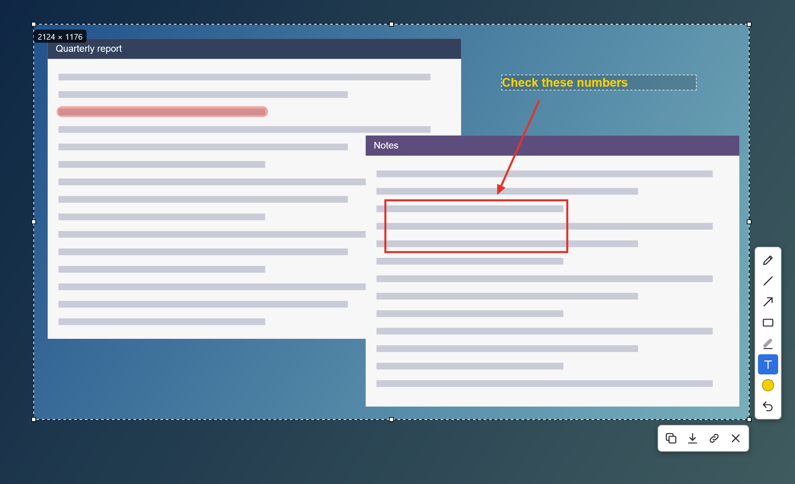

<div dir="rtl">

<p align="center"></p>

<h1 align="center">Just Screenshotter</h1>

<p align="center">כלי לצילומי מסך ללא עומס במנוחה עבור Windows‏, macOS ו־Linux</p>

<p align="center">
<a href="https://github.com/Ilia-Pero/just-screenshotter/actions/workflows/build.yml"></a>
<a href="../LICENSE"></a>

</p>

[English](../README.md) · [Русский](README.ru.md) · [Español](README.es.md) · [Ελληνικά](README.el.md) · **עברית** · [简体中文](README.zh.md) · [日本語](README.ja.md) · [한국어](README.ko.md) · [Српски](README.sr.md) · [Français](README.fr.md) · [Deutsch](README.de.md) · [Italiano](README.it.md)



לחצו על Print Screen, בחרו אזור, ציירו עליו והעתיקו, שמרו או העלו את התמונה. בין צילום לצילום התוכנה רק ממתינה למקש: אין לה חלונות ואין טיימרים, והיא אינה מעסיקה את המעבד.

## מה היא עושה

- מצלמת את כל המסכים ופותחת מעליהם את העורך.
- מציירת בעיפרון, קו, חץ, מסגרת, מרקר וטקסט בשמונה צבעים.
- מעתיקה את התמונה, שומרת אותה כ־PNG או מעלה אותה אל [השרת שלכם](../server/README.md) ומעתיקה את הקישור.
- מדברת 12 שפות. בהתחלה בשפת המערכת; שפה אחרת בוחרים בתפריט.
- אינה שולחת דבר מעצמה: אין חשבון, אין טלמטריה ואין בדיקת עדכונים. הרשת משמשת רק להעלאת תמונה אל השרת שהגדרתם.

## מקשים בעורך

| מקש | מה הוא עושה |
| --- | --- |
| Ctrl+C | מעתיק את האזור |
| Ctrl+S | שומר את האזור בתיקייה `Screenshots` שבתיקיית התמונות |
| Ctrl+U | מעלה את האזור, והקישור עובר ללוח |
| Ctrl+Z | מבטל את הציור האחרון |
| Esc | סוגר את העורך |

ב־macOS המקש ⌘ במקום Ctrl.

בתפריט הסמל שבמגש נמצאים קיצור המקשים, התיקייה, השפה, כתובת השרת והפעלה עם המערכת. הפעלה נוספת של התוכנה גם היא מצלמת את המסך.

## כמה היא קלה

נמדד ב־24.11.2026 ב־Windows Server 2022, מסך 1920 × 1080, גרסה ממוטבת:

| מה | תוצאה |
| --- | --- |
| מעבד במנוחה | 0 אלפיות השנייה ב־10 שניות |
| זיכרון במנוחה | 14 MB לפני הצילום הראשון, 25 MB אחרי שבעה |
| תהליכים במנוחה | 1 |
| מלחיצת המקש ועד העורך | 0.61–0.75 שניות בשבע הפעלות |
| גודל התוכנה | 5.0 MB |

העורך נפתח בפרק זמן כזה משום שהחלון שלו נוצר לכל צילום ונהרס אחריו. זה המחיר של אפס עומס במנוחה.

## מצב

| מערכת | מצב |
| --- | --- |
| Windows | עובדת ב־Windows Server 2022 עם מסך אחד. עדיין לא נבדקה ב־Windows 10 ו־11. |
| macOS 10.13+ | נבנית ועוברת את הבדיקות. איש עדיין לא הפעיל אותה. |
| Ubuntu 24.04+ | נבנית ועוברת את הבדיקות. איש עדיין לא הפעיל אותה. ב־Wayland מגדירים את הקיצור בהגדרות המקלדת: הפקודה היא `just-screenshotter`. |

## התקנה

עדיין אין קבצים מוכנים להורדה, ולכן צריך לבנות את התוכנה. דרושים Node.js 24 ומעלה ו־Rust, ב־Windows גם Microsoft C++ Build Tools, ב־Ubuntu גם `libwebkit2gtk-4.1-dev libayatana-appindicator3-dev librsvg2-dev libxdo-dev`.

</div>

```sh
git clone https://github.com/Ilia-Pero/just-screenshotter
cd just-screenshotter
npm ci
npm run tauri build
```

<div dir="rtl">

קובץ ההתקנה מופיע בתיקייה `src-tauri/target/release/bundle`. הוא אינו חתום, ולכן Windows ו־macOS ישאלו אם אתם סומכים עליו.

## תרגומים

התרגומים נעשו במכונה ולא נבדקו על ידי דוברי השפה. אם ראיתם טעות, תקנו אותה בתיקייה `locales` או `docs`.

## השתתפות ורישיון

איך לבנות, לבדוק ולשנות את התוכנה: [CONTRIBUTING.md](../CONTRIBUTING.md). הרישיון הוא [MIT](../LICENSE).

</div>
